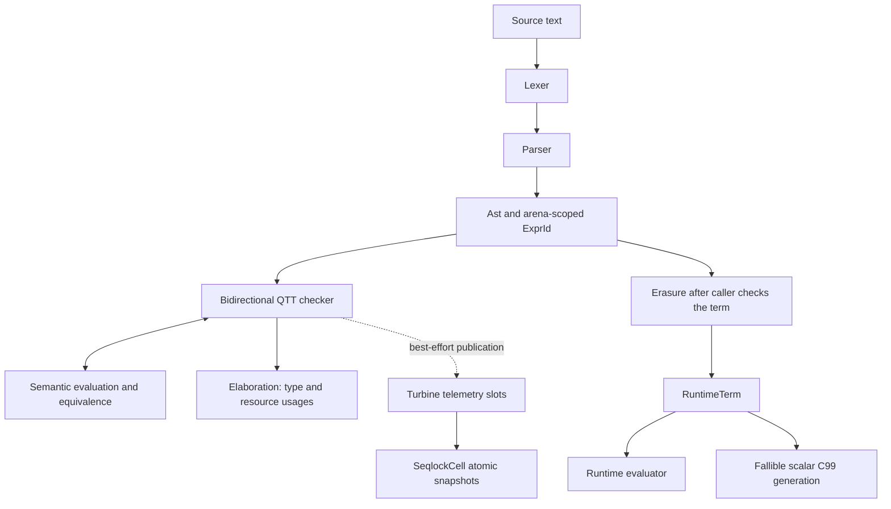
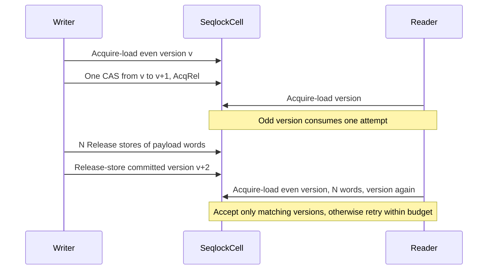
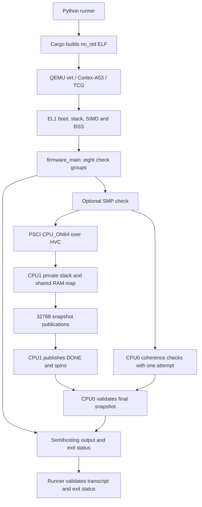

# AXIOM-0 architecture map

This map describes the working tree inspected on 2026-11-13, including local uncommitted changes. It records implementation boundaries and verification entrypoints. It is not a proof of type soundness or a new test-run report.

## Compilation and evaluation



The diagram shows the intended API workflow. `Elaboration` contains a type and usages, with no checked-term wrapper that enforces the transition to evaluation or erasure. The caller must preserve the accepted AST and its context. `eval` returns a `Value` and returns `Unit` for an invalid expression ID. `erase_expression` returns `Result<RuntimeTerm, AstError>`, does not perform full QTT checking, and erases `Hole` and `Meta` nodes. Successful evaluation or erasure alone therefore does not establish acceptance by the checker.

| Component | Entrypoints and role | Source |
| --- | --- | --- |
| Syntax arena | `Ast`, `ExprId`, `Level`, `Quantity`, `Plicity`. Expression IDs carry arena identity. Quantities are zero, exactly one, or unrestricted. | [ast.rs](src/ast.rs) |
| Text frontend | `Lexer::tokenize_all`, `Parser::parse_command`, `Parser::parse_expression`. Produces arena nodes from source text. Applications and binders retain explicit/implicit plicity. | [lexer.rs](src/lexer.rs), [parser.rs](src/parser.rs) |
| Bidirectional checker | `synthesize`, `check`, and their `_in_env` variants return `Elaboration { ty, usages }`. The `_with_turbine` entrypoints also publish telemetry. | [elaborator.rs](src/elaborator.rs) |
| Semantic evaluation | `eval`, `equiv`, `apply`, `Value`, `Neutral`, and `Closure`. The checker evaluates dependent types and compares semantic values. | [eval.rs](src/eval.rs) |
| Erasure | `erase_expression` produces `RuntimeTerm`. Removes zero-quantity binders and proofs, remaps retained levels, preserves computational components and natural recursion. | [erasure.rs](src/erasure.rs) |
| Runtime evaluation | `eval_runtime` evaluates erased terms, including runtime closures and recursion. It performs no typechecking. | [erasure.rs](src/erasure.rs) |
| C99 backend | `try_emit_c_code` returns generated source or `CodegenError`. Supports scalar results, branches, literal-pair projections and natural recursion. General applications, closures and pair-valued results are rejected. `emit_c_code` turns backend errors into a C `#error` diagnostic. | [codegen.rs](src/erasure/codegen.rs) |
| Hosted interface | `main` calls `start_repl`, which calls `run_repl`. The REPL maintains corresponding global names, values and types, and checks before evaluation. | [main.rs](src/main.rs), [repl.rs](src/repl.rs) |

Preserve branch usage parity, declared argument quantities, binder/application plicity and the separate `synth_ind` and `synth_j` helpers when changing the checker. In erasure, `Unit` remains a computational value and `Erased` marks removed content. The compatibility helper `is_erased` matches both variants, while `is_proof_erased` identifies only `Erased`.

The checker rejects a repeated visit to an expression ID with `SharedExpression`, so AST producers must create separate occurrences instead of freely sharing a DAG. Erased natural numbers use `u64` with saturating successor arithmetic. This runtime representation has a finite range.

## Feature and ownership boundaries

The library has no external Cargo dependencies. It forbids unsafe code and requires native pointer-width atomics with compare-and-swap. The `std` feature is enabled by default. Disabling it retains `alloc`, so the embedding executable must provide allocation and panic behavior.

| Facility | Default `std` build | `--no-default-features` |
| --- | --- | --- |
| AST, lexer, parser, explicit QTT checking, semantic evaluation | Available | Available with `alloc` |
| Explicitly supplied implicit arguments such as `{Nat}` | Available | Available |
| Erasure, runtime evaluation, C99 source generation | Available | Available with `alloc` |
| `SeqlockCell` | Available | Available using `core` |
| Turbine slots and `_with_turbine` checking entrypoints | Available | Available with `alloc` |
| Metavariable state, solving and automatic implicit insertion | Require a turbine | Excluded, holes and missing inferred arguments are rejected |
| Parallel batch elaboration and REPL executable | Available | Excluded |

Sources are [Cargo.toml](Cargo.toml), [lib.rs](src/lib.rs), [elaborator.rs](src/elaborator.rs) and [turbine.rs](src/turbine.rs). The REPL uses the ordinary context-aware checker entrypoints and does not create a turbine. Enabling `std` alone does not enable automatic implicit insertion for every caller.

`TurbineEngine::for_ast` fixes the slot capacity to the current arena size. Later AST additions have no slot. `TurbineEngine::new` binds to the first valid publication's arena. Each slot stores four atomic words encoding an elaboration summary. The checker still derives types from the AST and context. `try_get_cached` is a compatibility alias for telemetry reading and cannot justify skipping inference.

Hosted metavariable state uses `RwLock` and a unification `Mutex`. Parallel batch workers use scoped standard-library threads. These facilities have a separate synchronization path from the snapshot slots.

## Snapshot protocol and progress



The payload uses native atomics for every word. The sealed `AtomicValue` trait permits supported integer and boolean scalars. `SeqlockCell` has 64-byte alignment, private fields, whole-payload replacement and a version counter that refuses to wrap. A successful `Snapshot` contains the payload, committed even version and attempts used.

| Operation | Bound in Rust-level operations | Failure behavior |
| --- | --- | --- |
| `SeqlockCell::try_read(A)` | At most `A * (N + 2)` atomic loads | `RetryBudgetExhausted { attempts: A }`, including when `A` is zero |
| `SeqlockCell::try_write` | One load, at most one strong CAS, `N` payload stores and one commit store | `Contended` or `VersionExhausted` |
| `TurbineEngine::try_snapshot` | Arena validation and at most six loads per slot-read attempt | Also rejects unbound engines, foreign arenas and invalid slots |
| Allocation, AST construction, typechecking and hosted solving | Outside the snapshot operation bounds | May allocate, recurse, retry or use hosted locks |

These are bounded attempts, with no guarantee of a successful read under contention, a fresh result, or a wall-clock deadline. A writer paused while its version is odd can cause every read attempt to fail. The implementation does not establish a portable hardware wait-free guarantee. The firmware allocator's CAS retry loop and SMP handshake polling are also outside these bounds. See [seqlock.rs](src/seqlock.rs) and [allocator.rs](crates/qemu-firmware/src/allocator.rs).

## Bare-metal execution

The firmware is a separate Cargo workspace targeting `aarch64-unknown-none`. Its path dependency disables the library's default features. Its `build.rs` runs on the host and supplies the linker script. Guest code uses `no_std` and `no_main`.



| Area | Current layout or behavior | Source |
| --- | --- | --- |
| Image | Linker RAM range `0x40080000` to `0x48000000`, excluding the upper endpoint. Sections include text, read-only data, data, BSS and stacks. | [link.ld](crates/qemu-firmware/link.ld) |
| Primary boot | CPU0 at EL1, interrupts masked, 16-byte-aligned 1 MiB stack, FP/SIMD enabled, BSS cleared before Rust. | [boot.S](crates/qemu-firmware/src/boot.S) |
| Heap | Static 4 MiB bump allocator, aligned reservations with checked arithmetic and CAS, no reclamation. | [allocator.rs](crates/qemu-firmware/src/allocator.rs) |
| Console and exit | Arm semihosting character output and status-bearing exit, with a nonreturning fallback. The panic handler prints and exits with status 1. | [platform.rs](crates/qemu-firmware/src/platform.rs), [main.rs](crates/qemu-firmware/src/main.rs) |
| SMP memory | Both CPUs enable MMU/caches and share an identity mapping of `0x40000000` through `0x7fffffff` as Normal Inner Shareable RAM. This translation block is larger than the runner's 128 MiB guest RAM allocation. | [boot.S](crates/qemu-firmware/src/boot.S) |
| Secondary boot | `smp-test` adds CPU1 startup through PSCI and a private 64 KiB stack. CPU1 runs only the snapshot writer. | [boot.S](crates/qemu-firmware/src/boot.S), [smp.rs](crates/qemu-firmware/src/smp.rs) |
| Shared cell | CPU0 publishes a permanently live heap cell through `AtomicPtr` with Release/Acquire ordering. The payload has 128 `u64` lanes. | [smp.rs](crates/qemu-firmware/src/smp.rs) |

The SMP handshake first holds generation 1 until CPU0 validates it. CPU1 then publishes through generation 32,768. CPU0 validates accepted payloads against the reported version, checks nondecreasing even versions, counts exhausted one-attempt reads and checks the final version of 65,536 after completion. It requires observed contention. Accepted-read and exhaustion counts depend on host scheduling. The checkpoint guarantees an initial coherent sample, while intermediate successful reads are not guaranteed.

QTT checks run on CPU0 before the SMP test. This firmware does not demonstrate parallel QTT elaboration without `std`. The host runner bounds guest execution with a timeout. SMP polling has no independent guest watchdog. The platform assumes the runner's QEMU machine configuration and semihosting support. Hardware bring-up and hardware latency measurements are outside this map's evidence.

## Verification and change impact

| Change area | Checks to revisit |
| --- | --- |
| Quantities, plicity, dependent eliminators, equivalence | [elaborator/tests.rs](src/elaborator/tests.rs), [eliminator_tests.rs](src/elaborator/eliminator_tests.rs), QTT and eliminator guest checks |
| Erasure or C99 representation | [erasure/tests.rs](src/erasure/tests.rs), guest argument/proof erasure and natural-recursion checks |
| Metavariable solving | Hosted cyclic-occurs and concurrent-solution regressions in [erasure/tests.rs](src/erasure/tests.rs), hosted integration suites selected by Cargo |
| Snapshot protocol or atomic ordering | Unit tests in [seqlock.rs](src/seqlock.rs), guest sequential snapshots, telemetry and SMP checks |
| Boot, linker, allocator, semihosting or runner | Firmware build, single-vCPU execution, SMP execution and deliberate panic control |
| Feature gates | Root checks with defaults and without defaults, bare-metal library build and firmware build |

The shared local and CI entrypoint is [validate.py](validate.py). Run it from the repository root, or use its absolute path from another directory.

```sh
python3 validate.py
```

The validator runs every required stage and stops at the first failure. It retains the three exact root controls from AGENTS.md.

```sh
cargo check --workspace -q
cargo test --workspace -q
cargo clippy --workspace -- -D warnings
```

The root workspace commands do not include the standalone firmware workspace. The validator invokes that workspace explicitly, combining hosted formatting/all-target/stress coverage, host tests and Clippy without default features, a bare-metal release library build, firmware formatting and Clippy with default/all features, and three QEMU images. It runs the normal image first, then the SMP image and a separate single-vCPU panic control. `--qemu` selects the emulator. `--timeout` defaults to 30 seconds per guest and must be finite and positive.

The runner checks the ordered eight normal check groups, adds a ninth SMP group in that mode, validates the SMP metrics, and requires matching success markers and exit status. `--check-panic` builds a separate single-vCPU panic variant, requires the intentional-panic transcript and exit status 1, and rejects a success summary. Normal, SMP and panic builds use separate artifact directories. Timeout output is preserved in the mode's log.

The guest natural-recursion check generates and inspects C99 source. It does not compile or execute that C inside QEMU. The six original V1 regression families reside in [erasure/tests.rs](src/erasure/tests.rs), with additional checks in [v1_soundness.rs](tests/v1_soundness.rs) that compile and execute generated C. A hosted test harness with default features disabled is also distinct from executing the actual bare-metal ELF.

See the [root quickstart](README.md) for complete-suite prerequisites and the [firmware reproduction guide](crates/qemu-firmware/README.md) for targeted commands and the negative one-vCPU PSCI control. This map describes source files and configuration. It does not report a test execution.
