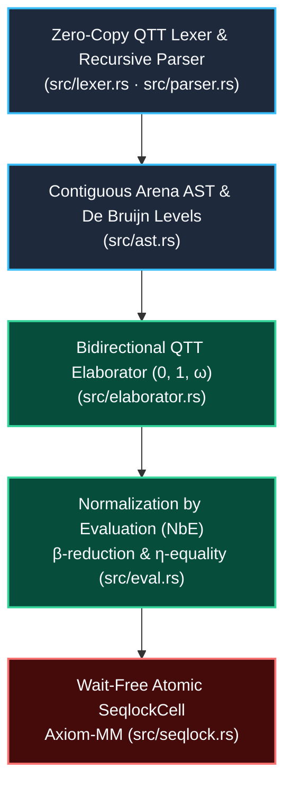

# Micro-AXIOM-0

> **Zero-Dependency Quantitative Type Theory (QTT) Kernel with Normalization by Evaluation (NbE), Cumulative Universes & Wait-Free Atomic Memory (`Axiom-MM`) in Pure Rust.**

[](https://github.com/borjamoskv/axiom-0/actions)
[](./LICENSE)
[-orange?style=flat-square)](./Cargo.toml)

---

## ⚡ Quickstart

Verify formatting, strict lints, formal QTT/NbE & Seqlock test suites, and launch the interactive REPL:

```sh
cargo fmt --all -- --check
cargo clippy --all-targets -- -D warnings
cargo test --all-targets
cargo run --bin micro-axiom-0
```

---

## 🧬 Architecture & Compilation Topology



```text
.
├── Cargo.toml
├── Cargo.lock
├── src/
│   ├── lib.rs              # Exportaciones públicas de Ring-0
│   ├── main.rs             # Punto de entrada interactivo REPL
│   ├── ast.rs              # Arena continua de expresiones y niveles De Bruijn
│   ├── lexer.rs            # Transductor léxico zero-copy con anotaciones QTT
│   ├── parser.rs           # Parser recursivo, comandos globales let y binders
│   ├── eval.rs             # Normalización por Evaluación (NbE), Valores y Cierres
│   ├── elaborator.rs       # Verificador bidireccional, subtipado cumulativo y álgebra QTT
│   ├── repl.rs             # Bucle interactivo de alta exergía con estado global
│   └── seqlock.rs          # Celda atómica lock-free / wait-free (Axiom-MM)
├── docs/
│   ├── MEMORY_MODEL.md     # Contrato formal y garantías de coherencia secuencial
│   └── snapshot-protocol.md
├── examples/
│   ├── snapshot.rs         # Demostración del protocolo de instantáneas
│   ├── stress_10k.rs       # Prueba de carga de 10.000 iteraciones
│   ├── stress_10k_rigorous.rs
│   └── stress_popperian_10k.rs # Falsación empírica masiva generativa
└── tests/
    ├── qtt_nbe.rs          # Verificación formal de NbE, QTT, universos y eta-igualdad
    ├── seqlock.rs          # Concurrencia, contención y exhaustión de versiones
    ├── seqlock_contract.rs
    ├── seqlock_handoff.rs
    ├── seqlock_model.rs
    └── seqlock_wide.rs
```

---

## 1. Fundamentos Teóricos y Semántica

### Semianillo Cuantitativo (QTT)
El cálculo modela recursos físicos mediante cantidades $\rho \in \{0, 1, \omega\}$:
- **`0` (Erased)**: Término puramente computacional/estático en tiempo de compilación. Borrado en tiempo de ejecución.
- **`1` (Linear)**: Consumo unívoco obligatorio. Prohibida la duplicación o el descarte (*drop*).
- **`\omega` (Unrestricted)**: Uso libre/afín (cero o más apariciones).

```text
    + | 0  1  ω           × | 0  1  ω
   ---+--------          ---+--------
    0 | 0  1  ω           0 | 0  0  0
    1 | 1  ω  ω           1 | 0  1  ω
    ω | ω  ω  ω           ω | 0  ω  ω
```

### Normalización por Evaluación (NbE)
La conversión no opera mediante sustituciones sintácticas ingenuas $O(2^n)$, sino proyectando la sintaxis muerta (`ExprId`) sobre el territorio semántico vivo (`Value`):
- Cierres semánticos de entorno diferido: `Closure { env, body }`.
- Valores neutrales para variables libres: `Neutral::Var(Level)` y aplicaciones neutrales encadenadas.
- Conversión semántica completa con **$\beta$-reducción** y **$\eta$-igualdad funcional** (`\x. f x == f`).

### Estratificación de Universos y Subtipado Cumulativo
Para erradicar la Paradoja de Girard (Burali-Forti en teoría de tipos), los universos están estratificados:
$$\mathrm{Type}_0 : \mathrm{Type}_1 : \mathrm{Type}_2 : \dots : \mathrm{Type}_n : \mathrm{Type}_{n+1}$$
- `type n` sintetiza estrictamente a `Value::Universe(n + 1)`.
- Se implementa **Subtipado Cumulativo**: $\mathrm{Type}_i \le \mathrm{Type}_j \iff i \le j$.
- El supremo de un producto dependiente satisface:
  $$\Pi (x : \mathrm{Type}_u) \to \mathrm{Type}_v : \mathrm{Type}_{\max(u, v)}$$

---

## 2. Sintaxis y REPL

El REPL (`cargo run`) expone un entorno global persistente:

```rust
=== AXIOM-0 REPL (Singularidad NbE) ===
Modo de Alta Exergía Activo. Presiona Ctrl+C para salir.

# Declaración lineal de identidad polimórfica:
> let id : fn :^1 (x: type 0) -> type 0 = fn :^1 x -> x;
id definido.
==> Val: Lam(One, Closure { ... })
    Typ: Pi(One, Universe(0), Closure { ... })

# Aplicación reducida por NbE:
> id UnitType
==> Val: UnitType
    Typ: Universe(0)

# Falsación de borrado: variable de tipo 0 usada computacionalmente falla
> let leak : fn :^0 (x: type 0) -> type 0 = fn :^0 x -> x;
Error de Tipado en Let: UsageMismatch { declared: Zero, observed: One }

# Falsación lineal: variable lineal descartada (drop) falla
> let drop : fn :^1 (x: type 0) -> type 1 = fn :^1 x -> type 0;
Error de Tipado en Let: UsageMismatch { declared: One, observed: Zero }
```

---

## 3. Modelo Atómico Axiom-MM (`seqlock.rs`)

`SeqlockCell<T, N>` implementa instantáneas atómicas secuenciales libres de bloqueos (*wait-free read*):
- Cero bloqueos de lectura concurrentes frente a escrituras.
- Barreras explícitas de adquisición y liberación (`Acquire` / `Release`).
- Control de contención con presupuesto de reintento determinista (`try_read`).
- Sellado formal de versiones pares e impares impidiendo estados intermedios.

---

## 4. License & Security

Distributed under the **MIT License** (see [`LICENSE`](./LICENSE)). Formal memory-model contracts and security invariants are documented in [`docs/MEMORY_MODEL.md`](./docs/MEMORY_MODEL.md) and `SECURITY.md`.
